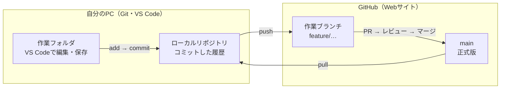

# Git/GitHub はじめてガイド（Kyoto Dev Circle）

最終更新：2026-10-30

## はじめに：GitとGitHubの違い

Gitは自分のPCで変更の記録をとる道具で、GitHubはその記録をネット上で共有する場所です。この2つを組み合わせると、2人で同じファイルを壊さずに作業できます。

- **Git**：ファイルの変更履歴を残すソフト。PCにインストールして使う。ゲームのセーブ機能のようなもの。
- **GitHub**：Gitの記録をネット上に置いておくWebサービス。PRやレビュー、Issueもここで行う。Googleドライブの、開発者向け版に近い。



最初にcloneで丸ごとコピーしたあとは、編集してコミットし、pushでGitHubに送ります。PRでmainに合体したら、pullで手元に取り込む、の繰り返しです。

このガイドの使い方は次のとおりです。

1. まず「用語集」で言葉の意味をざっくりつかむ（全部覚えなくてよい）。
2. 「最初に1回だけやる準備」を2人とも済ませる。
3. 普段は「毎回の作業の流れ」を見ながら手を動かす。
4. 困ったら「よくあるトラブル」と「コマンド早見表」を見る。

使う道具はVS Code（編集、コミット、push）とGitHubのWebサイト（PR、レビュー、マージ）の2つです。コマンドはVS Codeのターミナル（`Ctrl + @` で開く）に打ちます。

## 用語集

まずは太字の5つ（コミット、ブランチ、push、pull、PR）だけ分かれば大丈夫です。

| 用語 | 意味 | たとえ |
| --- | --- | --- |
| リポジトリ（repo） | 履歴ごと管理されたプロジェクトのフォルダ。手元にあるものをローカル、GitHubにあるものをリモートと呼ぶ | self-intro が1つのリポジトリ |
| clone（クローン） | GitHubのリポジトリを自分のPCに丸ごとコピーする。最初に1回だけ | 共有フォルダを手元にダウンロード |
| **コミット（commit）** | 変更を履歴に1件記録する。メッセージを付ける | ゲームのセーブ |
| add（ステージング） | 次のコミットに入れるファイルを選ぶ | 箱詰めする前に荷物を並べる |
| **ブランチ（branch）** | mainから枝分かれした作業用の線。mainを壊さずに試せる | 本番と別の下書き用紙 |
| main | 正式版のブランチ。このリポジトリでは直接pushできない | 清書 |
| **push（プッシュ）** | 手元のコミットをGitHubに送る | アップロード |
| **pull（プル）** | GitHubの最新の変更を手元に取り込む | 最新を取り込んで合体 |
| **PR（プルリクエスト）** | 「私のブランチをmainに入れてください」という申請。GitHub上で作る | 提出前のチェック依頼 |
| レビュー / Approve | PRの変更をもう1人が確認し、OKなら承認する | 添削してハンコを押す |
| マージ（merge） | ブランチの変更をmainに合体させる | 下書きを清書に反映 |
| Issue（イシュー） | やることや不具合を書くチケット。番号（#2 など）が付く | ToDoカード |
| コンフリクト（衝突） | 2人が同じ行を別々に変えたとき、Gitが自動で合体できない状態 | 同じ欄に2人が違うことを書いた |
| origin | リモート（GitHub側）のリポジトリの呼び名 | 「GitHub」と読み替えてOK |

## 最初に1回だけやる準備

準備は4つで、終わればVS Codeでself-introリポジトリを開ける状態になります。コマンドはすべてVS Codeのターミナル（`Ctrl + @`）に打ちます。

※ `Ctrl + @` は日本語配列キーボードの場合です。英語配列なら `` Ctrl + ` `` で開きます。

### 1. Gitが入っているか確認する

```bash
git --version
```

`git version 2.xx.x` のように表示されればOKです。「認識されません」と出たら、[git-scm.com](https://git-scm.com/) からWindows版をダウンロードしてインストールします。途中の選択肢はすべて初期設定のまま「Next」で大丈夫です。インストール後はVS Codeを再起動してください。

### 2. 名前とメールアドレスを登録する

コミットに「誰が変更したか」を残すための設定です。名前はGitHubのユーザー名、メールはGitHubのnoreplyアドレスにします。

```bash
git config --global user.name "GitHubのユーザー名"
git config --global user.email "GitHubのnoreplyアドレス"
git config --global pull.rebase false
git config --global core.editor "code --wait"   # エディタをVS Codeにする
```

- **メールはnoreplyアドレスを使う**：GitHubの Settings → Emails に表示される `数字+ユーザー名@users.noreply.github.com` の形のアドレスです。「メールアドレスを公開するpushをブロック」が有効だと、gmailなどを設定した場合はpushが拒否されます。
- **3行目**：pullのときに出る警告を消すための設定です。
- **4行目（エディタをVS Codeにする）**：初期設定のままだとVimが開き、`git pull` でマージのメッセージ入力になったときに止まってしまいます。VS Codeでタブが開いたら、そのまま閉じれば続きが進みます。

`git config --global --list` で登録内容を確認できます。

### 3. リポジトリをcloneする

作業用のフォルダ（例：ホームフォルダの中の dev）を作り、そこへ移動してからcloneします。

```bash
mkdir ~/dev
cd ~/dev
git clone https://github.com/kyoto-dev-circle/self-intro.git
```

`self-intro` というフォルダができれば成功です。

clone先を `~/Documents` にしないのは、Documents がOneDriveで同期されていると、Gitとぶつかることがあるためです。

### 4. VS Codeで開き、GitHubにサインインする

1. VS Codeの「ファイル」→「フォルダーを開く」で `self-intro` を選ぶ。「作成者を信頼しますか」と聞かれたら「はい」。
2. 左下の人型アイコン（アカウント）からGitHubにサインインする。ブラウザが開くので「Authorize」を押す。
3. 初めてpushするときにもブラウザでサインインを求められることがあります。画面の指示どおり許可すれば、次回からは聞かれません。

ここまでできたら、ターミナルで `git status` と打ってみましょう。`On branch main` と出れば準備完了です。

## 毎回の作業の流れ

1つの作業は「Issueを確認→ブランチ→編集→コミット→push→PR→レビュー→マージ→pull」の9ステップです。下の例は #2（自分の自己紹介ファイルを追加する）の場合です。番号や内容は自分のIssueに合わせて変えてください。

### ① Issueを確認する（GitHub）

タスクボードで自分のIssueを「In progress」に動かします。Issue番号（例：#2）を覚えておきます。

### ② mainを最新にして、ブランチを作る（VS Code）

```bash
git switch main
git pull
git switch -c feature/#2-add-hayato
```

- 1行目：mainブランチに移る
- 2行目：相方が入れた変更を取り込む（これを忘れるとコンフリクトの原因になる）
- 3行目：新しいブランチを作って移る（`-c` は create の意味）

VS Codeの左下にブランチ名が表示されているので、今どこにいるかをここで確認できます。

### ③ ファイルを編集して保存する（VS Code）

普通に編集して `Ctrl + S` で保存します。変更したファイルは、左のファイル一覧で色が変わります（新規は緑のU、変更は黄色のM）。

### ④ コミットする（VS Code）

```bash
git status
git add .
git commit -m "feat: 自己紹介を追加"
```

- `git status`：何が変わったか確認する（迷ったらいつでも打ってよい）
- `git add .`：変更したファイルをすべてコミット対象にする（`.` は「全部」）
- `git commit -m "..."`：メッセージ付きで記録する

メッセージの頭は、変更の種類で使い分けます。

| 頭に付ける言葉 | 使うとき |
| --- | --- |
| feat: | 新しい機能やページを追加した |
| fix: | 不具合を直した |
| docs: | READMEや文章だけの変更 |
| style: | コードの書式だけの変更（インデント・空白など。動きや見た目は変わらない） |
| refactor: | 動きを変えずにコードを書き直した |

CSSでデザインを変えたときは、`style:` ではなく `feat:` や `fix:` を使います。

ボタンでやる場合：左端の枝分かれアイコン（ソース管理、`Ctrl + Shift + G`）を開き、ファイル名の横の「＋」→ 上の欄にメッセージを入力 →「コミット」。

### ⑤ pushする（VS Code）

```bash
git push -u origin feature/#2-add-hayato
```

「このブランチをGitHubに送る」という意味です。`-u` を付けるのは初回だけで、同じブランチで2回目以降は `git push` だけで済みます。ボタンでやる場合は、ソース管理の「ブランチの発行」を押します。

### ⑥ PRを作る（GitHub）

1. ブラウザで [self-introリポジトリ](https://github.com/kyoto-dev-circle/self-intro) を開く。
2. 黄色い帯の「Compare & pull request」を押す。出ていなければ「Pull requests」タブ →「New pull request」で、compareに自分のブランチを選ぶ。
3. タイトルを書き、本文のテンプレートを埋める。`Closes #2` を必ず入れる（マージ時にIssueが自動で閉じる）。
4. 右側の「Reviewers」で相方を選び、「Create pull request」を押す。
5. Slackの #github に通知が出るので、必要ならスレッドで「レビューお願いします」と一言添える。

慣れたら、VS Codeの拡張機能「GitHub Pull Requests」からもPRを作れます。左端のGitHubアイコンを開き、「Create Pull Request」（＋マーク）を押すと、タイトルや本文をVS Codeの中で書けます。最初のうちは、画面と用語を覚えるためにWebで作るのがおすすめです。

### ⑦ レビューを待つ・直す

修正を頼まれたら、同じブランチのまま③〜⑤をもう一度やります（pushは `git push` だけでOK）。同じPRに自動で追加されるので、PRを作り直す必要はありません。

Approveされた後に新しいコミットをpushすると、その承認は自動で取り消されます。直したら、相方にもう一度レビューを頼みましょう。

### ⑧ マージする（GitHub）

Approveされたら、**PRを出した本人がマージ**します。「Merge pull request」→「Confirm merge」を押し、その後に出る「Delete branch」も押して、GitHub上の作業ブランチを片付けます。

マージ方法は **Merge pull request** だけが使えるように設定しています。**Squash and merge** でマージすると、⑨の `git branch -d` がエラーになるためです。

例外として、長谷川（maintainersチーム）はApproveがなくてもPRをマージできます（バイパス）。PR画面のマージボタンの近くにある「Merge without waiting for requirements to be met (bypass rules)」にチェックを入れると、「Merge pull request」が押せるようになります。バイパスは、代表の長谷川が自分の判断で使ってよいことにしています。mainへの直接pushは、長谷川もできません。

### ⑨ 手元をmainに戻す（VS Code）

```bash
git switch main
git pull
git branch -d feature/#2-add-hayato
```

マージ後のmainを取り込み、手元の作業ブランチを削除します。これで1サイクル完了です。

## レビューする側の手順

レビューはすべてGitHubのWebサイトで行い、変更を読んで問題がなければApproveします。Approveが1件ないとmainにはマージできません（例外は⑧を参照）。

1. Slackの #github の通知、またはGitHubの「Pull requests」タブからPRを開く。
2. 「Conversation」タブで本文を読み、何のための変更かをつかむ。
3. 「Files changed」タブで変更を見る。緑の行が追加、赤の行が削除です。
4. 気になる行があれば、行番号の横の「＋」を押してコメントを書き、「Start a review」を押す。
5. 右上の「Review changes」を押し、3つから1つを選んで「Submit review」。
   - **Comment**：感想や質問だけ。承認も差し戻しもしない
   - **Approve**：問題なし。マージしてよい
   - **Request changes**：直してほしい。直したらもう一度見る
6. 修正がpushされたら、もう一度「Files changed」を確認してApproveする。

コメントは「ここ、〜のほうが分かりやすいかも？」のように、理由と提案をセットにすると伝わりやすいです。良いところを見つけたら、それも一言書きましょう。

自分で出したPRは自分でApproveできない仕組みです。必ず相方に頼みましょう。

慣れたら、同じ拡張機能「GitHub Pull Requests」を使って、VS Codeの中で差分を見ながらコメントやApproveもできます。左端のGitHubアイコンから対象のPRを開きます。

## コンフリクトが起きたときの直し方

コンフリクトは壊れたわけではなく、「どちらを残すか人間が決めて」という合図です。自分のブランチに最新のmainを取り込んで、手元で直します。

PRの画面に「This branch has conflicts that must be resolved」と出たら、次の順で進めます。

1. 自分の作業ブランチにいることを確認し、最新のmainを取り込む。

   ```bash
   git switch feature/#2-add-hayato
   git pull origin main
   ```
2. `CONFLICT` と表示されたファイルをVS Codeで開く。次のような印が入っています。

   ```text
   <<<<<<< HEAD
   自分の書いた内容
   =======
   相方がmainに入れた内容
   >>>>>>> 3f9a2c1（英数字はコミットの番号。毎回違う）
   ```
3. 印の上に出るボタンから1つを選ぶ。
   - 「現在の変更を取り込む」：自分の内容を残す
   - 「入力側の変更を取り込む」：相方の内容を残す
   - 「両方の変更を取り込む」：両方を並べて残す

   手で書き直しても構いません。その場合は `<<<<<<<`、`=======`、`>>>>>>>` の行も忘れず消します。
4. 保存して、直したことをコミットしてpushする。

   ```bash
   git add .
   git commit -m "fix: コンフリクトを解消"
   git push
   ```
5. PRの画面を更新し、コンフリクトの表示が消えたことを確認する。

どちらを残すか迷ったときは、一人で決めずにSlackで相方に聞きましょう。コンフリクトを減らすコツは、作業を始める前に必ず `git pull` することと、2人で同じファイルの同じ場所を触らないように分担することです。

## よくあるトラブルと対処

困ったら、まず `git status` を打って状態を確認します。それでも分からなければ、エラー文をそのままSlackの #questions に貼りましょう。

| こんなとき | 原因 | 対処 |
| --- | --- | --- |
| mainにpushしようとして断られた（`protected branch` など） | mainは直接push禁止の設定 | ブランチを作ってそちらにpushする（下の行を参照） |
| mainのまま編集やコミットをしてしまった | ブランチを作り忘れた | `git switch -c feature/#番号-内容` で新しいブランチを作れば、変更もコミットもそのまま続きを作業できる。手元のmainは次の `git pull` の前に相談して整える |
| `git switch` で「Your local changes would be overwritten」 | 保存したがコミットしていない変更がある | 先にコミットしてから切り替える |
| pushで「rejected」「fetch first」 | GitHub側に手元にない変更がある | `git pull` してからもう一度 `git push` |
| コミットしたら謎の黒い画面が出て止まった | `-m` を付け忘れて編集用の画面（Vim）が開いた | `Esc` を押して `:q!` と打ちEnter。もう一度 `-m "メッセージ"` 付きでコミット |
| コミットメッセージを間違えた（push前） | ― | `git commit --amend -m "正しいメッセージ"` |
| `git` が「認識されません」 | Gitが未インストール、またはVS Codeを再起動していない | 準備の1をやり直し、VS Codeを再起動 |
| PRのマージボタンが押せない | Approveがまだない、Approveの後にpushして承認が取り消された、またはコンフリクトがある | 相方にレビューを頼む（取り消された場合はもう一度頼む）。コンフリクトなら前の章の手順で直す |
| 何が起きたか全く分からない | ― | 変なコマンドを重ねずに手を止め、`git status` の結果をSlackに貼って相談する |

ネットで見つけた `--force` や `reset --hard` は、変更が消えることがあるので、意味が分かるまでは使わないでください。

## コマンド早見表

普段使うのはこの表のコマンドだけです。例は #2 の場合なので、番号と内容は自分のIssueに合わせて変えてください。

| やりたいこと | コマンド |
| --- | --- |
| 今の状態を確認する | `git status` |
| mainに移る | `git switch main` |
| GitHubの最新を取り込む | `git pull` |
| ブランチを作って移る | `git switch -c feature/#2-add-hayato` |
| ブランチの一覧を見る（\* が今いる場所） | `git branch` |
| 変更をコミット対象にする | `git add .` |
| コミットする | `git commit -m "feat: 自己紹介を追加"` |
| 初めてpushする | `git push -u origin feature/#2-add-hayato` |
| 2回目以降のpush | `git push` |
| 変更の中身を見る（コミット前） | `git diff` |
| 履歴を見る | `git log --oneline` |
| 使い終わったブランチを消す | `git branch -d feature/#2-add-hayato` |

`git log` や `git diff` の表示が長くて止まったように見えたら、`q` を押すと戻れます。
